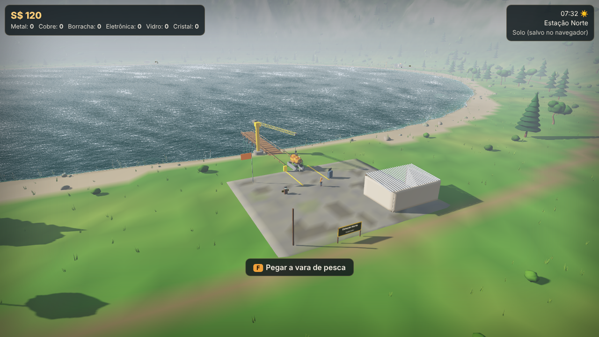

# ABISMO DE SUCATA

Jogo 3D cooperativo (1 a 5 jogadores) de exploração e recuperação de sucata num lago misteriosamente fundo. Você começa com um submarino velho e enferrujado, pesca no cais, recolhe sucata no fundo, vende, recicla e restaura na sua estação, melhora o submarino, a vara de pesca, o aquário e a base, e vai descendo da bacia rasa até a Câmara do Mistério, a 4.300 m.

Roda no navegador (WebGL2), sem nenhum asset externo: terreno, árvores, personagens, submarinos, peixes, sons e água são gerados por código. As texturas (casca com relevo, folhas recortadas, pedra, ferro, madeira, concreto e o casco do sub com chapas, rebites e ferrugem) também são procedurais, no mesmo método usado no WildLens. O multiplayer usa um servidor Node.js com WebSocket que valida todas as ações (dinheiro, inventário, pesca, arremessos, tinta) e salva o perfil de cada jogador.

> **Status: protótipo jogável v0.9** (chat de voz por distância, Kraken do abismo, corrida de submarino, estilingue de lixo, mais peixes e peças)



---

## 1. Jogar agora (no seu computador)

Requisito: [Node.js 20+](https://nodejs.org).

```bash
npm install
npm start
```

Abra **http://localhost:8080** e escolha:

- **Jogar sozinho / Continuar jogo solo**: o progresso fica salvo neste navegador (localStorage), sozinho.
- **Jogar com amigos — minhas salas**: lista suas salas (Sala 1, Sala 2…) com código e % de evolução. Ali você **cria uma nova sala**, **entra** numa delas ou **digita o código** que um amigo passou (ou abre o link `…/?sala=CÓDIGO`). Dentro do jogo, **Tab** mostra o código, o link de convite e o botão **Sair do jogo (já está salvo)**.

Na mesma rede (casa), seus amigos podem abrir `http://IP-DO-SEU-PC:8080`.

## 2. Jogar com amigos à distância (só com o link da sala)

O link só funciona se o servidor estiver acessível pela internet. Escolha uma opção:

### Opção A — Render (recomendado, um clique)
1. Suba este repositório para o seu GitHub (seção 3).
2. Em [render.com](https://render.com): **New → Blueprint** → escolha o repositório. O arquivo `render.yaml` já configura tudo no **plano grátis** (sem cartão).
3. Quando terminar, abra `https://SEU-APP.onrender.com`, clique em **Jogar com amigos → Criar nova sala** e mande o código (ou o link de convite) para os amigos.

> No plano grátis o servidor dorme depois de 15 min sem jogadores (a primeira entrada demora ~1 min) e apaga os arquivos ao reiniciar. **As salas não se perdem:** o servidor manda a cada jogador uma cópia assinada da sala (a cada poucos segundos), o navegador guarda e, quando o servidor acorda vazio, o jogo devolve a cópia sozinho — mesmo código, mesma estação, mesmo dinheiro. Só se perde se todos daquela sala apagarem os dados do navegador ou trocarem de aparelho. Para salvar no servidor para sempre, use o plano `starter` com o bloco `disk` (pago).

### Opção B — Túnel temporário a partir do seu PC (rápido para uma noite de jogo)
```bash
npm start
# em outro terminal (Cloudflare Tunnel, gratuito):
cloudflared tunnel --url http://localhost:8080
```
Ele mostra um endereço `https://….trycloudflare.com`. Abra esse endereço, crie a sala e mande o código. O servidor fica no seu PC: se você desligar, ninguém entra até você ligar de novo, mas as salas e o progresso continuam salvos em `./data` (o endereço do túnel muda a cada vez; o código da sala não).

### Opção C — Docker (Fly.io, Railway, VPS)
```bash
docker build -t abismo .
docker run -p 8080:8080 -v abismo-dados:/data abismo
```

### Opção D — Cliente no GitHub Pages + servidor em outro lugar
O workflow `.github/workflows/pages.yml` publica o cliente no Pages. Crie a variável do repositório **`ABISMO_SERVIDOR`** (Settings → Secrets and variables → Actions → Variables) com o endereço do servidor (ex.: `https://abismo.onrender.com`). Sem essa variável, o Pages funciona só no modo solo. Também dá para passar o servidor na URL: `?servidor=https://…`.

## 3. Subir para o GitHub

```bash
git init
git add .
git commit -m "ABISMO DE SUCATA v0.1"
gh repo create abismo-de-sucata --public --source=. --push   # ou crie o repositório no site e use git remote add + git push
```
O workflow `ci.yml` roda os testes de regras e do servidor a cada push.

---

## 4. Controles

| A pé | | Submarino (câmera sempre de fora) | |
|---|---|---|---|
| WASD / Shift | andar / correr | W / S | avançar / ré |
| Espaço | pular | A / D | virar |
| Mouse | olhar (clique na tela para capturar) | **C** (ou Ctrl) | afundar |
| **E** | interagir (computador, aquário, berço, mesa de tinta) | **Q** (ou Espaço) | subir · no berço, fora d'água: sair do sub |
| **F** | pegar a vara (só no píer ou na beira d'água) | **E** | garra (pega, traz para perto e guarda) · guindaste perto do cais |
| Clique (segurar e soltar) | lançar a linha · clique na mordida · segurar para recolher | L | faróis (mais fortes a cada melhoria) |
| **G** | pegar o peixe para arremessar → mire e clique com o botão esquerdo | **B** | lançar bolsa de tinta com o braço |
| **X** | soltar o peixe | V | câmera perto / médio / longe |
| **Z** | guardar/tirar o peixe da mochila (até 5 peixes e 10 bolsas de tinta) | R | sonar |
| Roda do mouse | roda de emotes (5): mova o mouse ou role, clique para fazer | T | computador da estação (no berço/cais) |
| **1–5** | equipar pistola / submetralhadora / fuzil / sniper / bazuca (se comprou) · **H** guardar | | |
| Clique / botão direito (armado) | atirar / luneta da sniper | | |
| **E** na margem | catar lixo (garrafa PET, latinha…) → saco de recicláveis | | |
| **E** na estátua | colocar as peças achadas no fundo do lago | | |
| I / Tab / J | inventário / sala e convite / mapa | | |
| **M** | chat de voz liga/desliga | | |
| **E** no lixo · **E** de novo · **Q** | catar · guardar no saco · estilingue (mira e clique) | | |
| **Y / N** | aceitar / recusar convite de corrida | | |

Jogo apenas para PC (teclado e mouse). Todo jogador começa com 1 bolsa de tinta; a casinha ao lado da estação tem a mesa e a placa explicando como fabricar mais (1 lula → 2 bolsas). O compartimento do sub começa com 5 objetos e melhora no computador (8/12/18/25).

---|---|---|---|
| WASD / Shift | andar / correr | W / S | avançar / ré |
| Espaço | pular | A / D | virar |
| Mouse | olhar (clique na tela para capturar) | Espaço / Ctrl ou C | subir / descer |
| **E** | interagir (terminal, aquário, berço do sub, bancadas) | **E** | garra (perto da sucata) · guindaste (no berço ou perto do cais) |
| **F** | pegar/guardar a vara | L | faróis |
| Clique (segurar e soltar) | lançar a linha · clique na mordida · segurar para recolher | R | ping do sonar |
| **G** | pegar o peixe para arremessar (mão para trás) → mire e clique com o botão esquerdo | **B** | balão de tinta (com lançador instalado) |
| **X** | soltar o peixe | V | câmera cabine / externa |
| I / Tab / J | inventário / sala e convite / mapa | Q | sair do sub (no berço) |

No celular aparece um joystick virtual e botões (suporte básico, não testado em aparelho real).

---

## Novidades da v0.9.6

- O peixe (ou tubarão) cortado na bancada agora vai **picado para a mão**: cabeça, rabo e filés.
- Na bancada, com o peixe cortado na mão: **E** guarda na mochila. Tubarão cortado também cabe na mochila (inteiro não).
- **Z** tira o próximo peixe da mochila para cortar. Corte vários e venda tudo junto.
- Novo botão **Vender todos os peixes** no computador (mão + mochila), com o total em S$.

## Novidades da v0.9.5

- **Recicladora saiu da loja** (componentes não são mais necessários; o HUD só mostra componentes se você ainda tiver algum).
- **Bancada de restauro — S$ 1.000**, agora com colisão. Restaurar é **grátis** e funciona com **qualquer item** (lixo, metal, sucata do lago) direto do submarino, da mochila de sucata ou do depósito. Item restaurado vende pelo **dobro**.
- **Bancada de peixe — S$ 2.000**, no lugar da antiga recicladora, com colisão. Com um peixe de **mais de 2 kg na mão**: **E** coloca na tábua, **I** corta (animação com faca), **I** pega o peixe cortado. Peixe cortado vende pelo **dobro**. Usar é grátis. Peixe cortado não entra no aquário.

## Novidades da v0.9.4

- **Peixe do aquário não é mais vendido sem querer:** a aba "Vender" do computador só mostra o peixe da mão e da mochila. Para vender um peixe do aquário ou do tanque, tire primeiro (aba Aquário → **Pegar na mão**) e depois venda.
- **Sem caixa térmica:** com o peixe na mão, as opções agora são Vender, Guardar na mochila, Aquário/Tanque, Arremessar e Soltar. Quem ainda tinha peixe na caixa térmica antiga continua vendo esses peixes para pegar ou vender.

## Novidades da v0.9.3

- **Melhorias do submarino 3× mais caras** (casco, propulsores, bateria, faróis, sonar, braço, carga e oxigênio). Continuam só com dinheiro.

## Novidades da v0.9.2

- **Decorações: equipar e desequipar.** Depois de comprada, cada decoração tem o botão **Desequipar** (some da estação) e **Equipar** (volta), sem pagar de novo.
- **Tubarão do lago:** um tubarão aparece 20 min depois de a sala abrir e fica rondando a frente dos píeres, só com a barbatana de fora. Ele não ataca ninguém e a vida não aparece na tela. É **um só por vez**: o próximo só começa a contar 20 min depois que este morrer. Tem **200 de vida** (25 tiros de pistola, por exemplo). Quando cai, fica **boiando**: quem estiver com a mão livre nada até lá e aperta **E** para pegar; leva na mão até o computador da sua estação e vende por **S$ 400**. Se quem está levando levar um tiro (ou peixe, ou estilingue), **deixa o tubarão cair** ali mesmo, no chão ou na água, e qualquer um pode pegar. **X** larga.
- **Dano na loja:** cada arma mostra o dano (vale para o Kraken e o tubarão). As pessoas nunca perdem vida: nelas o acerto só derruba. Estilingue agora tira **1** de vida do Kraken e do tubarão.

## Novidades da v0.9.1

- **Estação só com dinheiro:** tudo do computador da estação (recicladora, bancada de restauro, iluminação, carregador rápido, decoração, depósito, lançador e luvas) não pede mais metal nem outros componentes. Os preços continuam os mesmos.
- **8 decorações novas e baratinhas:** vasos de flores (S$ 90), flamingos de plástico (S$ 90), boias salva-vidas no cais (S$ 90), banco de praça (S$ 100), varal de luzinhas coloridas (S$ 100), guarda-sol com cadeira de praia (S$ 100), churrasqueira (S$ 100) e rede de descanso (S$ 100). Cada uma aparece num canto da estação, e os amigos também veem.

## Novidades da v0.9

- **Chat de voz por distância:** aperte **M** para ligar/desligar o microfone. Aparece "Chat de voz ativado/desativado" em cima da tela por 2 s e o estado fica no canto de baixo. Você ouve quem está até ~69 m (3 vezes a base da estátua), mais alto quanto mais perto; de outra estação não se ouve. Funciona de navegador para navegador (WebRTC); o servidor só faz a ponte inicial. Algumas redes (escola, empresa) podem bloquear a voz.
- **Mapa** mudou para a tecla **J** (o M agora é o chat de voz).
- **Ranking** dos 3 mais ricos da sala no quadro do canto superior direito, embaixo do nome da estação.
- **Mais peixes e mais caros:** 18 espécies (novas: piranha, traíra, pacu, tambaqui, dourado, pintado e o lendário peixe-lua-dourado). Tucunaré S$ 170 (antes 65), pirarucu S$ 850, tubarão S$ 3.000.
- **O dobro de peças no fundo do lago**, 100 lixos na margem, e tudo **reaparece em segundos em outro lugar** (lixo em 3–8 s, peças do fundo em 5–12 s). Sucata do fundo vale 60% a mais, lixo 2,5× mais.
- **Estilingue de lixo (S$ 400):** primeira arma da loja (a pistola agora pede o estilingue). Cate o lixo com **E** (ele fica na mão), **E** de novo guarda no saco, **Q** mira com o mesmo arco do peixe e o clique atira. Sem lixo na mão, usa o do saco. Derruba o amigo por 1 s. Não machuca o Kraken.
- **Queda mole:** quem é acertado cai de costas no chão (não fica mais "dançando" em pé). Peixe e estilingue derrubam no lugar; as armas de fogo jogam para longe (pistola um pouco, bazuca muito).
- **Breakdance** na roda de danças (scroll): de cabeça para baixo girando.
- **Kraken do abismo:** polvo gigante (5× o submarino) que surge no meio do lago a cada 20 min (aviso 1 min antes) e fica 1 min rondando perto dos píeres. Contagem e vida em cima da tela. Vida calculada para 5 pistolas, 4 submetralhadoras, 3 fuzis, 2 snipers ou 1 bazuca derrubarem em 1 minuto atirando bastante. Se cair, **todo mundo da sala ganha S$ 1.000**.
- **Corrida de submarino:** barraca nova ao lado da loja de armas, com troféus e uma bola brilhante. Na bola (E), escolha os amigos (o botão verde fica cinza), clique em **Chamar para corrida**; cada um aceita com **Y** ou recusa com **N**. Quem aceita vai para dentro do submarino, lado a lado no lago, contagem 3-2-1 e 5 palitos brilhantes sobre a água (só os corredores veem). Quem pegar todos primeiro vence: com 2 corredores ganha S$ 200 e o outro paga S$ 200; de 3 a 5, ganha S$ 250 divididos entre os que perderam. No fim, todos voltam para onde estavam.
- O tanque de peixes agora fica atrás da barraca da corrida.

## Novidades da v0.8

- **Varas:** 8 níveis — bambu, telescópica (S$ 90), fibra (S$ 250), fibra reforçada, carbono com molinete, titânio, oceânica e a lendária do abismo (S$ 11.000). Dá para pular direto para qualquer uma melhor.
- **Aquários (decoração):** 9 modelos, dos baratinhos aos grandes — Nano (grátis), Redondo de peixinho (S$ 40), de Mesa (S$ 90), Pequeno, Plantado, de Corais, Médio, Grande e Panorâmico (14 vagas). Cada estilo tem visual próprio (bola de vidro, plantas e tronco, corais coloridos).
- **Tanques de peixe** evoluem um por um: Lona → Concreto → Concreto Duplo → Abissal (com luz azul e corais) → Oceânico (peixes até 6 m).
- **Mochila com até 5 peixes:** Z guarda o peixe da mão e tira de volta; com o peixe na mão, G arremessa no amigo.
- **Aba "Vender" no computador:** vende tudo num lugar só — peixe na mão, na mochila, na caixa térmica, no aquário e no tanque (cada um com *Vender* e *Pegar na mão*), o lixo catado e a carga do submarino.

## Novidades da v0.7

- **Lago em funil:** o fundo desce em cone, sem paredes, da margem até a boca da fenda (33 m de raio a 110 m de profundidade). A parede da fenda começa exatamente onde o funil termina, então não sobra fresta para ver fora do mapa.
- **Câmera do submarino** para antes de qualquer rocha (e, se precisar, encosta no submarino): não atravessa mais a parede.
- **Colisão:** pedras do lago (com o tamanho real do modelo) e pedras da margem bloqueiam o personagem e o submarino; o cais (tábuas e estacas) é sólido para o submarino.
- **Casinhas** de tinta e de armas fechadas até o telhado, com ripas de madeira e telhado reto apoiado nas paredes.

## Novidades da v0.6

- **Menu:** *Jogar sozinho / Continuar jogo solo* (salvo no navegador) e *Jogar com amigos — minhas salas*.
- **Salas permanentes:** cada sala é um jogo salvo separado, com **código que nunca muda**. A lista mostra *Sala 1, Sala 2…*, o código, quem é o líder, quantos jogadores, quantos estão online e **quanto % você já evoluiu** nela. Dá para ter até 12 salas próprias.
- **Salvamento automático no servidor:** a cada compra/venda/coleta, a cada 15 s e ao sair. Para continuar outro dia, o líder entra pela lista e os amigos digitam o mesmo código; cada um volta para a mesma estação com o mesmo progresso (testado inclusive reiniciando o servidor).
- **Até 5 jogadores**, com estações a cada 72° ocupadas em sequência (dois jogadores ficam vizinhos). Uma base só aparece quando alguém está nela. **Cores e nomes não se repetem**: quem tenta entrar com a cor de outro vê "Alguém já está com essa cor". Agora são 7 cores.
- **Submarino melhora só com dinheiro** (sem componentes).
- **Missões rápidas:** sempre 3 na tela (pegue um pneu, pegue latas, cate lixo, pesque, venda, desça até X m, acerte um amigo…). Completam sozinhas e pagam na hora; o prêmio cresce a cada missão concluída.
- **Lixo:** 90 itens na margem (garrafas PET, sacos de lixo, latinhas, sacolas, potes), maiores e fáceis de ver; menos sucata na parte rasa da água.
- **Mira do peixe:** com G, aparece o marcador de onde o peixe vai cair (e o arco pontilhado); o peixe vai exatamente para onde a mira aponta.
- **Estátua** e a praça dela 30% maiores, com degraus em rampinha (sem tropeço) e sem árvores em cima.

## Novidades da v0.5

- **Barraca de armas** ao lado da casinha de tinta (mesmo tamanho), com computador para comprar armas e balas. Ordem obrigatória: Pistola (S$ 900) → Submetralhadora (S$ 3.500) → Fuzil (S$ 9.000) → Sniper (S$ 20.000) → Bazuca (S$ 45.000). Balas baratas (S$ 20 a 180 por pente/foguete).
- Cada tiro derruba o amigo **a pé** e o empurra: pistola 2 s no chão e um empurrãozinho; submetralhadora 3 s; fuzil 4 s; sniper 5,5 s; bazuca 7 s e ele voa longe (explosão com raio de 4,5 m). Depois de levantar há uma imunidade curta para ninguém ficar preso no chão.
- **Estátua do Abismo** na praça entre a Estação Norte (de quem cria a sala) e a Leste: 11 peças (2 tênis, 2 pernas, tronco de baixo e de cima, 2 braços, 2 mãos e a cabeça) espalhadas abaixo de 300 m; a cabeça fica no altar da Câmara do Mistério (4.294 m). Uma peça só encaixa depois das anteriores (tênis → perna, pernas → tronco…); as outras esperam no depósito. Cada peça soma +0,6× ao multiplicador de dinheiro e a cabeça +3× (máximo 10×). Enferrujada enquanto incompleta; dourada ao terminar (o jogo mostra que você zerou e você continua jogando). Cada jogador monta a sua (a peça que você pega continua no fundo para os amigos).
- **Lixo na margem** (garrafas PET, latinhas, sacolas, potes): E abaixa e cata, vai para o saco de recicláveis (15) e se vende no computador da estação.
- **Fendas**: a parede da boca agora começa acima do fundo inclinado da bacia (antes sobrava uma fresta por onde se via fora do mapa) e as entradas das cavernas foram abertas na parede.
- **Submarino evolui mais rápido**: melhorias 40% mais baratas e com menos componentes; os faróis também aumentam a visibilidade debaixo d'água; o casco nível 4 vai a 4.400 m (alcança a cabeça da estátua).

## 5. O que existe e qual é o status

**T-unit** = teste automatizado de regras (`tests/rules.test.mjs`) · **T-srv** = servidor real com clientes WebSocket (`tests/server.test.mjs`) · **T-e2e** = jogo real no Chrome (`tests/e2e_solo.mjs`, `tests/e2e_multi.mjs`) · **Visual** = inspecionado em captura do jogo rodando.

| Sistema | Status |
|---|---|
| Lago de ~150 m, 5 vagas de estação (aparecem conforme os jogadores entram), margem com trilha, floresta e montanhas como barreira natural | Implementado · Visual |
| Água: ondas, Fresnel, reflexo do céu e da margem, refração com absorção pela profundidade, espuma na margem, vista de baixo (janela de Snell) | Implementado · Visual |
| Profundidade em etapas: raso → naufrágios (100–500) → escuridão (500–1.500) → fenda (1.500–4.000) → Câmara do Mistério (4.000+), com patamares, 3 cavernas laterais, naufrágios, cristais e ruínas | Implementado · T-unit (colisão navegável) · Visual |
| Ciclo de dia e noite (1 dia = 24 min), luz subaquática que some com a profundidade, faróis com cones de luz | Implementado · Visual |
| **Gancho/guindaste**: o sub sai do berço, é içado, a lança gira e ele desce **ao lado do cais**; ao tocar a água há respingo (gotas sobem e caem), anéis de onda e bolhas; na volta, E perto do cais prende o gancho e o sub sai pingando água | Implementado · T-e2e |
| Submarino: aceleração, inércia, arrasto, lastro, flutuação na superfície, colisão com fundo/paredes/rochas/naufrágios (SDF), pressão, bateria, oxigênio, subida de emergência | Implementado · T-e2e (não atravessa o fundo) |
| 8 melhorias do sub que mudam a física **e** o visual (casco, propulsores, bateria, faróis, sonar, braço, carga, oxigênio) | Implementado · T-unit (casco muda profundidade) · Visual |
| Sucata (17 tipos com modelos próprios), garra com alcance e peso, carga por kg e litros, item some para todos | Implementado · T-unit · T-e2e |
| Vender, reciclar em componentes, restaurar em itens valiosos, depósito da estação | Implementado · T-unit · T-e2e (venda) |
| Contratos (7), incluindo **içar a âncora gigante com dois submarinos** | Implementado · T-unit |
| Pesca: lançamento com força, boia, mordida sorteada pelo servidor, minijogo de tensão, linha que arrebenta | Implementado · T-e2e · T-srv |
| 4 varas + equipamento pesado; peixe grande demais arrebenta a vara fraca | Implementado · T-unit |
| 11 espécies (incluindo lula e tubarão), cardumes com steering, fauna profunda (peixe-lanterna, água-viva, peixe-diabo) | Implementado · Visual |
| Aquário nano com exatamente 1 peixe ≤ 12 cm, aquários maiores, tanques de concreto com vidro reforçado; peixes nadando dentro | Implementado · T-unit · T-e2e |
| Lula → bancada de tinta → 2 balões → lançador na escotilha → vidro do amigo fica preto até **emergir** (nunca por tempo), sonar/HUD continuam, cooldown e proteção | Implementado · T-unit (fluxo completo) · Visual (vista da cabine) · **não testado com dois navegadores** |
| Arremessar peixe em jogador em terra: "VOCÊ FOI ACERTADO POR UM PEIXE!", 3 s parado; tubarão com luvas: mordida cartunesca, 7 s; colisão real simulada no servidor; peixe sai do inventário | Implementado · T-unit · T-srv · T-e2e (dois navegadores) |
| Botão/tecla Soltar (peixe volta para a água) | Implementado · T-e2e |
| Personagens estilizados com rig hierárquico e animações procedurais (parado, andar, correr, pular, nadar, pescar, lançar, recolher, arremessar, carregar, bancada, atordoado com estrelinhas, sentado no sub, embarque) | Implementado · Visual |
| Câmeras: 3ª pessoa com colisão, cabine com moldura de escotilha, 3ª pessoa do sub | Implementado · Visual |
| Áudio procedural (motor, ambiente, sonar, estalos do casco, respingos, efeitos cômicos) | Implementado · **não verificado** (ambiente de testes sem som) |
| Interface em pt-BR: HUD, terminal com abas, depósito, aquário, contratos, inventário, mapa, sala/convite | Implementado · T-e2e |
| **Multiplayer até 5**: salas permanentes com código fixo, lista de salas com % de evolução, 6º recusado, cor e nome únicos, uma estação por jogador, interpolação, eventos sincronizados | Implementado · T-srv · T-e2e — **depende do servidor rodando** |
| Progresso por jogador **e por sala** salvo no servidor (gravação atômica + backup), token secreto, mesma estação ao voltar, salvamento ao sair e ao desligar o servidor, reenvio de ações sem duplicar | Implementado · T-srv · T-e2e — **depende do servidor rodando** |
| Modo solo com save no navegador (com backup) | Implementado · T-e2e |
| Tempestades, drones de coleta, cosméticos, troca de itens entre jogadores | **Planejado** |

### Como funcionam as salas e o progresso
Cada sala é um jogo salvo: o seu progresso (dinheiro, submarino, estátua, armas, aquário, estação) é guardado no servidor **por sala**, e o código da sala nunca muda. Você é identificado por um token salvo no navegador; a lista "minhas salas" mostra as salas que você criou e as que já entrou. Para usar a mesma conta em outro navegador, por enquanto é preciso copiar a chave `abismo_cred_…` do localStorage (login com senha está planejado).

O modo solo e o modo online têm progressos separados (o solo fica no navegador e não pode ser enviado ao servidor, para evitar trapaça).

---

## 6. Testes (última execução)

```bash
npm test                          # regras + servidor real (inclui reiniciar o servidor): 32/32
npm start                         # em outro terminal, para os testes no navegador:
node tests/e2e_solo.mjs           # 41/41 (Chrome real, SwiftShader)
node tests/e2e_multi.mjs          # 36/36: dois navegadores, sala, arremesso, chat de voz (microfone falso), corrida de submarino, sair e voltar
# o e2e_multi precisa do servidor com ABISMO_TESTE=1 (libera só a ação de teste que define o dinheiro)
node tools/build-html.mjs saida.html  # gera o HTML único (precisa de esbuild)
node tools/tour.mjs               # capturas de tela de várias cenas
```
Os testes e2e usam o Playwright e o Chrome já instalados no ambiente de desenvolvimento (caminhos em `tools/shot.mjs`); ajuste os caminhos se for rodar em outra máquina.

**Desempenho:** o ambiente de testes só tem renderização por software (SwiftShader, 1–3 FPS em qualquer cena), então **não foi possível medir FPS numa placa de vídeo real**. Há 3 níveis de qualidade automáticos (`?q=0`, `?q=1`, `?q=2` na URL forçam um nível) e `?fps` mostra o contador. Na superfície o nível médio desenha ~1,5 milhão de triângulos por quadro; debaixo d'água, a floresta e a margem são recortadas.

---

## 7. Estrutura do código

```
shared/   world.js (geografia determinística + SDF de colisão), data.js (tabelas), rules.js (regras autoritativas), room.js (sala)
server/   server.js (HTTP + WebSocket, salas, laço de 20 Hz), store.js (perfis em disco)
client/   index.html, style.css, config.js
  src/engine   math, geometry (primitivas procedurais), renderer (WebGL2, sombras, MSAA, água), shaders
  src/world    terrain (lago, fenda, cavernas, rochas, naufrágios), vegetation, fauna, env (dia/noite e água)
  src/entities character, submarine (modelo + física), station (base, guindaste, aquário), items
  src/systems  input, particles, audio
  src/net      net.js (mesma interface para solo e online)
  src/ui       ui.js
tests/    rules.test.mjs, server.test.mjs, e2e_solo.mjs, e2e_multi.mjs
tools/    shot.mjs, tour.mjs
```

As mesmas regras (`shared/rules.js`) rodam no servidor e no modo solo. O cliente nunca muda dinheiro ou inventário sozinho: ele envia ações com um id único e o servidor valida distância, saldo, capacidade, cooldown e estado do alvo. Ações repetidas com o mesmo id são ignoradas, então uma queda de conexão no meio de uma compra não cobra duas vezes.

**Limitação conhecida de segurança:** o movimento é do cliente (o servidor só recusa teletransporte e movimento durante atordoamento). Para um jogo entre amigos isso basta; para servidores públicos seria preciso simular o movimento no servidor.

## 8. Licença
MIT. Todo o conteúdo (modelos, texturas, sons) é procedural e original deste projeto.
